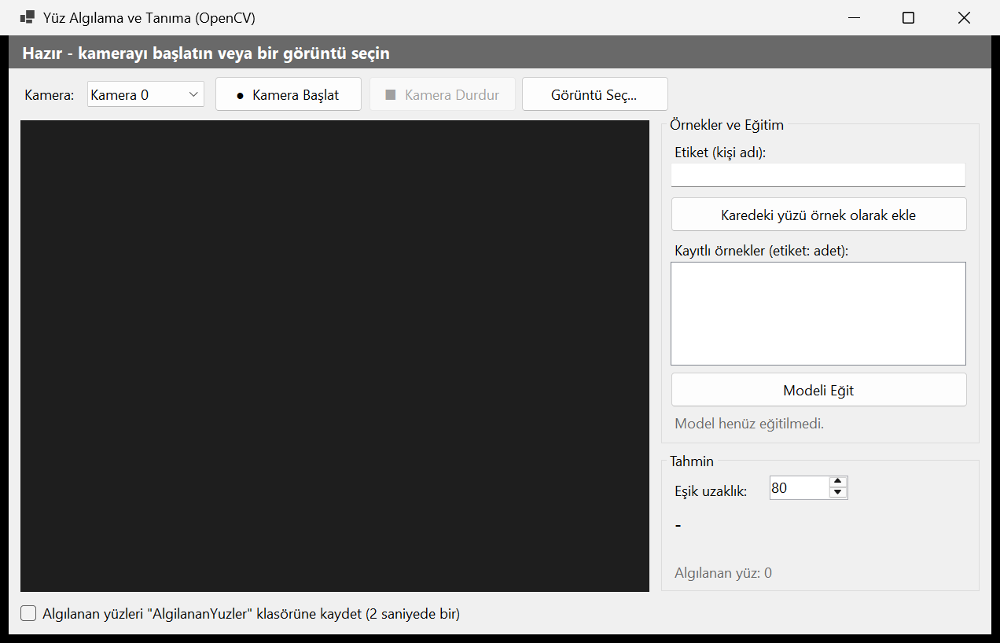
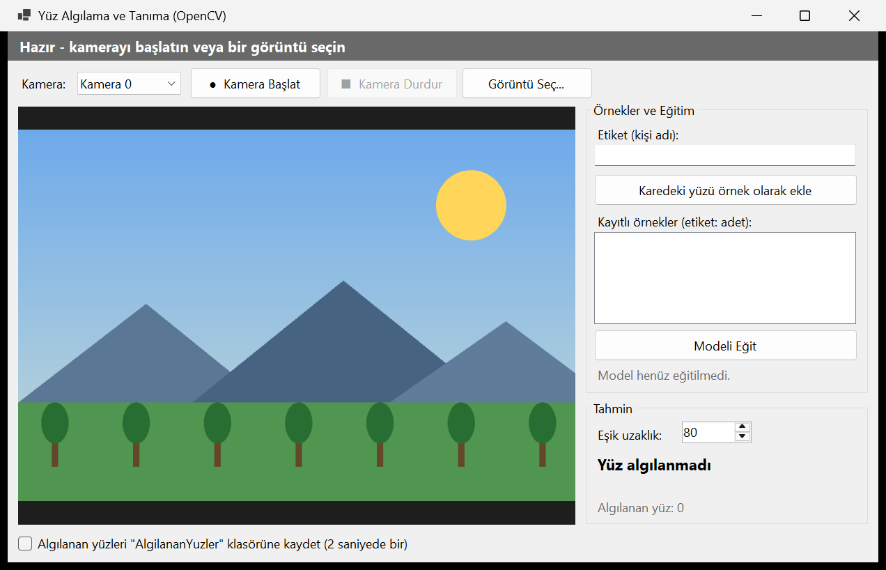

# YMH219-FaceRecognition

OpenCV ile yüz algılama ve tanıma yapan Windows Forms uygulaması. Kameradan veya seçilen bir resimden alınan görüntüde yüzler bulunup dikdörtgenle işaretlenir; kullanıcının uygulama içinde oluşturduğu küçük yerel örnek kümesiyle eğitilen model, yüzün kime ait olduğunu tahmin eder ve güven skorunu gösterir.

Nesne Tabanlı Programlama (YMH 219) dersi ek uygulama ödevidir.

## Kullanılan Teknolojiler ve Paketler

- C# / .NET 10, Windows Forms
- [OpenCvSharp4](https://github.com/shimat/opencvsharp) (NuGet `OpenCvSharp4.Windows`, `OpenCvSharp4.Extensions` 4.13)
- Yüz algılama: OpenCV Haar Cascade (`Kaynaklar/haarcascade_frontalface_default.xml`, OpenCV deposundan)
- Yüz tanıma: LBPH (Local Binary Patterns Histograms) — `OpenCvSharp.Face.LBPHFaceRecognizer`

## Sınıf Yapısı

| Sınıf | Görevi |
|---|---|
| `KameraYakalayici` | Kamerayı açar, kareleri arka plan görevinde okuyup olayla bildirir |
| `YuzAlgilayici` | Haar Cascade ile yüzleri bulur; yüzü 100x100 gri ve ışığı dengelenmiş hâle getirir |
| `YuzTanimaModeli` | LBPH modelini eğitir ve tahmin yapar; eşik uzaklığın üstü "Bilinmiyor" sayılır |
| `TahminSonucu` | Tahmin edilen etiket, uzaklık ve güven yüzdesi |
| `YuzOrnegi` | Eğitimde kullanılan bir yüz görüntüsü ve etiketi |
| `OrnekDeposu` | Örnekleri `Ornekler/<etiket>/*.png` düzeninde kaydeder ve yükler |
| `AnaForm` | Arayüz, kutu ve etiket çizimi, kamera ile arayüz arasındaki iş parçacığı geçişi |

## Kurulum ve Çalıştırma

Gereksinimler: Windows 10/11 (64 bit), .NET 10 SDK (Visual Studio 2026 ".NET masaüstü geliştirme" iş yüküyle gelir), kamera (isteğe bağlı; resim dosyasıyla da çalışır).

**Visual Studio ile:** `FaceRecognition.slnx` dosyasını açın ve `Ctrl+F5` ile çalıştırın.

**Komut satırıyla:**

```bash
dotnet run --project FaceRecognition
```

## Kullanım

1. **Kamera Başlat** ile kamerayı açın (birden fazla kamera varsa listeden seçin) veya **Görüntü Seç** ile bir resim açın.
2. **Etiket** kutusuna kişinin adını yazın, kamerada tek bir yüz varken **Karedeki yüzü örnek olarak ekle** düğmesine farklı açılardan 10–15 kez basın.
3. En az iki farklı etiket için örnek ekleyip **Modeli Eğit**'e basın.
4. Kamerada veya seçilen resimde yüzlerin etrafında tahmin edilen etiket ve güven yüzdesi görünür. **Eşik uzaklık** küçüldükçe tanıma daha seçici olur.

## Özellikler

- Kamera görüntüsü veya seçilen resim üzerinde yüz algılama ve dikdörtgenle işaretleme
- Aynı karede birden fazla yüzü ayrı ayrı işaretleme ve etiketleme
- Uygulama içinden örnek ekleme ve model eğitme ekranı
- Tahmin edilen etiket ve güven skoru (yeşil: tanındı, turuncu: bilinmiyor, sarı: model eğitilmedi)
- İsteğe bağlı: algılanan yüzleri `AlgilananYuzler` klasörüne kaydetme
- Kamera açılamazsa, görüntü gelmezse veya yüz algılama modeli bulunamazsa uygulama kapanmaz, kullanıcıya mesaj gösterilir

## Ekran Görüntüleri

Gizlilik nedeniyle ekran görüntülerinde gerçek bir kişinin yüzü kullanılmamıştır; yüz tanıma örneği canlı demoda gösterilir.

Uygulamanın açılış ekranı (kamera seçimi, örnek ekleme/eğitim paneli ve tahmin alanı):



**Görüntü Seç** ile açılan, yüz içermeyen bir resim; uygulama "Yüz algılanmadı" sonucunu veriyor:



## Gizlilik ve Kapsam

Bu çalışma yalnızca ders kapsamında, gönüllülerin izniyle alınmış yerel örneklerle kullanılmak içindir. Yüz örnekleri (`Ornekler/`) ve algılanan yüzler (`AlgilananYuzler/`) kişisel veri olduğu için `.gitignore` ile repodan hariç tutulur ve hiçbir yere gönderilmez.

## Bilinen Sınırlamalar

- Haar Cascade önden bakan yüzlerde iyi çalışır; yandan bakan veya çok karanlık yüzleri kaçırabilir.
- LBPH basit bir yöntemdir; ışık ve açı değişimine duyarlıdır. Farklı ışık ve açılardan örnek eklemek doğruluğu artırır.
- "Güven yüzdesi", LBPH uzaklığından (100 − uzaklık) türetilmiş yaklaşık bir göstergedir, gerçek bir olasılık değildir.
- Yalnızca Windows'ta (64 bit) çalışır.

## Geliştirici

Ebubekir Yılmaz – 250541051
